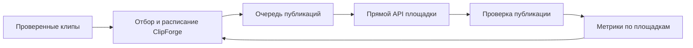

# Массовая публикация ClipForge

Исследование от 23 сентября 2026 года. Текущее требование пользователя: один YouTube-канал, 100 клипов каждый день, без разделения по темам, играм и стримерам, из всего доступного готового материала. Публикация через бесплатный прямой API. Архивные бракованные пробы не возвращаются в очередь. Это проект реализации; массовая отправка ещё не запущена.

## Предлагаемое решение

ClipForge ведёт очередь готовых клипов, расписание и результаты на собственной инфраструктуре. Текущий объём реализации — один YouTube-канал через существующий прямой клиент. Instagram и TikTok отложены; сведения ниже сохранены для последующих этапов. Buffer, Ayrshare и другие тарифные посредники не входят в решение.

Результат не должен зависеть от открытого браузера или ручного нажатия кнопок. Администратор подключает каналы и задаёт политику запуска. Дальше приложение пополняет очередь автоматически; помощник сообщает о результатах и исключениях, которые невозможно устранить автоматически.

## Бесплатная публикация с достаточным суточным объёмом

В нашем модуле не будет подписки за публикации, тарифа за подключённый аккаунт или оплачиваемого размера очереди. Очередь и файлы размещаются на собственном оборудовании; их практическая ёмкость зависит от диска, сети и вычислительных ресурсов. Расходы на инфраструктуру этим не отменяются.

Целевой суточный объём задан пользователем: 100 опубликованных клипов на одном канале. Стандартная документированная API-квота — 100 вызовов загрузки в сутки на Google Cloud проект. Это число попыток API, а не гарантия 100 успешных публикаций: ошибки, фактическая квота проекта, дневные ограничения канала и недостаток готовых клипов учитываются отдельно. При необходимости запаса под повторы запрашивается расширение квоты. Суточное окно квоты YouTube сбрасывается по Pacific Time; оно не должно смешиваться с часовым поясом календаря публикаций. [Квоты](https://developers.google.com/youtube/v3/determine_quota_cost), [запрос расширения](https://developers.google.com/youtube/v3/guides/quota_and_compliance_audits), [ограничения канала](https://support.google.com/youtube/answer/57407?hl=en).

Для TikTok документация указывает обычно около 15 постов за 24 часа на автора, с вариациями по аккаунтам. Основной нерешённый вопрос — допустимость нашего полностью автономного сценария, а не только число публикаций. Для Instagram точный текущий лимит здесь не утверждается: официальная страница при повторной проверке вернула 429; при подключении нужно прочитать лимит аккаунта. Текущий режим разработки с малым количеством проверочных клипов сохраняется. [Лимиты и условия TikTok](https://developers.tiktok.com/docs/en/content-sharing-guidelines).

## Условия площадок

**YouTube.** Собственный непроверенный API-проект может загружать только приватные видео; установка `public` этого не отменяет. Требуется аудит. В текущей документации `videos.insert` имеет отдельную квоту 100 вызовов в сутки на проект, стоимость одного вызова — одна единица этой квоты. Фактический лимит проекта проверяется в Google Cloud Console; ограничения канала учитываются отдельно. [Загрузка](https://developers.google.com/youtube/v3/docs/videos/insert), [квоты](https://developers.google.com/youtube/v3/determine_quota_cost).

Комментарий про 1 600 единиц и примерно шесть загрузок в сутки в `packages/youtube/src/index.ts` устарел. Калькулятор Google тоже содержит старую автоматически сформированную сводку, но основной текст, таблица и документация метода согласованно указывают новую квоту. Нельзя рассчитывать рабочий бюджет по старому комментарию.

OAuth Testing и аудит YouTube — разные вопросы. У внешнего OAuth-приложения в Testing refresh token с YouTube scopes истекает через семь дней. Для автономной эксплуатации нужно настроить production OAuth и применимые проверки; отзыв доступа владельцем всё равно потребует переподключения. Повторная проверка 23 сентября 2026 успешна: подключён канал «Кузня Клипов», токен работает. В Cloud Console проекта `valid-climber-507122-a3` подтверждены 100 загрузок в день. [Google OAuth](https://developers.google.com/identity/protocols/oauth2#expiration).

**Instagram.** Прямая публикация Reels поддержана для профессиональных аккаунтов Business/Creator. Instagram Login не требует связанной Facebook Page. Нужны разрешения публикации; файл передаётся по доступному извне URL, затем проверяется готовность контейнера и выполняется публикация. [Instagram Login](https://www.postman.com/meta/instagram/folder/6raa77c/instagram-api-with-instagram-login), [официальная коллекция Meta с процессом Reels](https://www.postman.com/meta/instagram/documentation/6yqw8pt/instagram-api?entity=request-23987686-3fe78620-2258-44b6-893f-42d76c7200d7). Численный лимит публикаций здесь не фиксируем без проверки текущего endpoint и аккаунта.

**TikTok.** Собственный Direct Post API требует аудита для публичности. Правила исключают внутренний загрузчик только на свои/командные аккаунты и перенос произвольного контента с других площадок; требуют выбора приватности пользователем. Поэтому текущий полностью автономный агрегатор Twitch нельзя обещать подключить напрямую без изменения сценария. Подтверждённого полностью автономного решения для нынешней модели пока нет. [Правила TikTok](https://developers.tiktok.com/docs/en/content-sharing-guidelines).

Для TikTok нужна отдельная версия без добавленных приложением рекламных логотипов, ссылок и outro: это также следует из правил TikTok. Публикации начинаются с источников, на использование которых есть разрешение; нахождение стримера в каталоге само по себе не означает разрешение на распространение его видео.

## Что уже есть и что требуется изменить

В проекте есть PostgreSQL/pg-boss, `platform_accounts`, `publications`, `publication_metrics`, уникальность `(clipId, platform, account)`, поле `scheduledAt`, реальная проверка публичности YouTube и сбор базовой статистики. Это основа для расширения; отдельный брокер сообщений сейчас не требуется.

В `apps/worker/src/automation.ts` планировщик выбирает первый YouTube-аккаунт и сразу отправляет лучшие клипы в пределах внутреннего бюджета, по умолчанию пять за скользящие сутки. Это не календарь и не учёт фактических API-вызовов. `scheduledAt` в этом обходе не используется.

В `packages/youtube/src/index.ts` создаётся resumable-сессия, но её адрес не сохраняется и возобновление после сбоя не реализовано. `apps/worker/src/metrics.ts` восстанавливает статус, если `mediaId` уже известен. Сбой после принятия файла площадкой, но до сохранения ID остаётся неоднозначным. Повтор такой операции вслепую способен создать дубль.

Предлагаемые части реализации:

1. **`packages/publishing`**: контракт адаптера — возможности аккаунта, подготовка, отправка, проверка результата, отмена запланированного, статистика. На текущем этапе только прямой YouTube.
2. **Планировщик**: общая очередь всего готового материала для одного выбранного канала, целевой объём 100 клипов в день. Без тематических ограничений и распределения по другим каналам. Конкретные слоты хранит ClipForge; внутренний бюджет разработки отдельно от внешних квот. Уникальность момента и проверки качества сохраняются.
3. **Хранилище медиа**: собственная HTTPS-раздача файлов там, где площадке нужен URL. Ссылка должна оставаться доступной до завершения доставки. YouTube может получать поток непосредственно с локального диска. Для новых публикаций использовать только проверенные текущие версии клипов.
4. **Надёжная отправка**: сохранять provider, providerPostId, uploadSession, попытки, время следующей проверки и причину остановки. Атомарно резервировать задания и бюджет; восстанавливать очередь после перезапуска. При таймауте сначала выяснять исход уже созданной операции. Если результат установить нельзя — помечать как требующий разбора, не отправлять повторно вслепую.
5. **Защита от дублей**: кроме существующей уникальности по clipId, учитывать исходный эфир и интервал. Перерендер того же момента не должен автоматически создавать новую публикацию в том же канале. Смена провайдера также не повод публиковать заново.
6. **Проверка и обратная связь**: «принято сервисом» не равно «опубликовано». Сохранять отдельные результаты по каждой площадке, ссылку, фактическую видимость и время. Собирать доступные метрики через 1/6/24/72 часа, сравнивать клипы одинакового возраста внутри площадки и канала. Не складывать просмотры разных площадок как полностью сопоставимые величины.
7. **Автономность**: повторять временные ошибки с задержкой, учитывать квоты и `Retry-After`; при отзыве доступа останавливать только затронутый канал. Помощник обновляет одну карточку клипа со всеми площадками, а не создаёт сообщение на каждый опрос.

Перед будущим подключением платных пользователей потребуются владелец и права на каждый внешний аккаунт, изоляция очередей и защищённое хранение токенов. Сейчас можно использовать один административный контур, сохранив эту границу в модели.

## Порядок запуска и критерии готовности

1. Подготовить адаптер и режим предварительного плана, который показывает реальные клипы, каналы, версии и слоты без отправки. Не менять текущий режим разработки и не создавать массово новые клипы ради проверки доставки.
2. Проверить подключение выбранного YouTube-канала, production OAuth, требования аудита и фактические квоты проекта.
3. Провести небольшой реальный пилот на согласованных клипах. Критерий: ссылка на площадке, корректный аккаунт, публичность, воспроизведение и доступные метрики. Заглушки API не заменяют этот этап.
4. Проверить восстановление после перезапуска, таймаута и истечения URL; повторное задание не должно порождать повторный ролик. Искусственные сбои проверять локально, не создавая поток публикаций в реальные аккаунты.
5. После проверки доставки запускать заданный пользователем режим: один канал, 100 клипов в день. Не подменять его предложением двух–четырёх или 10–20 публикаций. Если готового материала меньше, показывать нехватку явно, не дублировать клипы и не возвращать архивный брак.

Производство клипов планировать под 100 ежедневных публикаций и небольшой запас после завершения стадии проверки качества. Это целевая производственная нагрузка, а не разрешение массово создавать новые непроверенные пробы во время исследования доступа.
